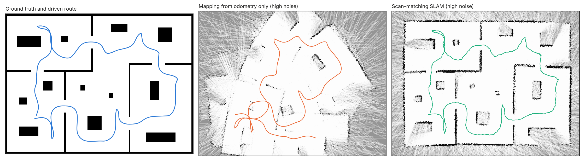
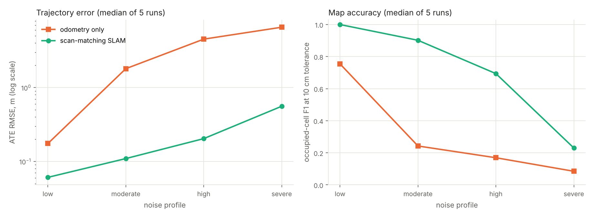
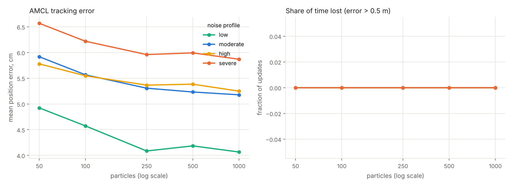
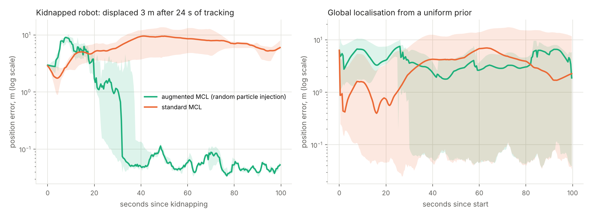
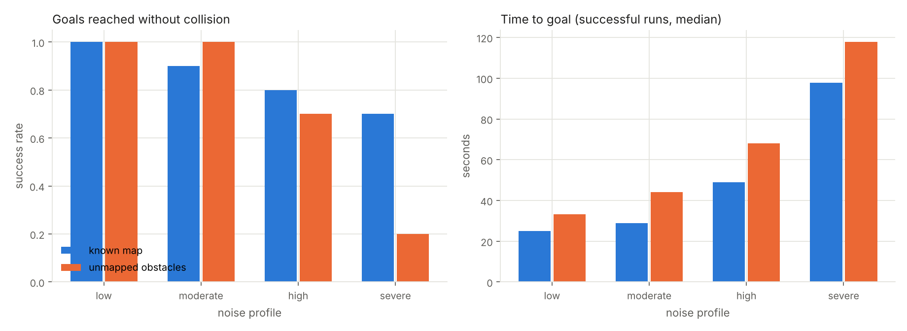
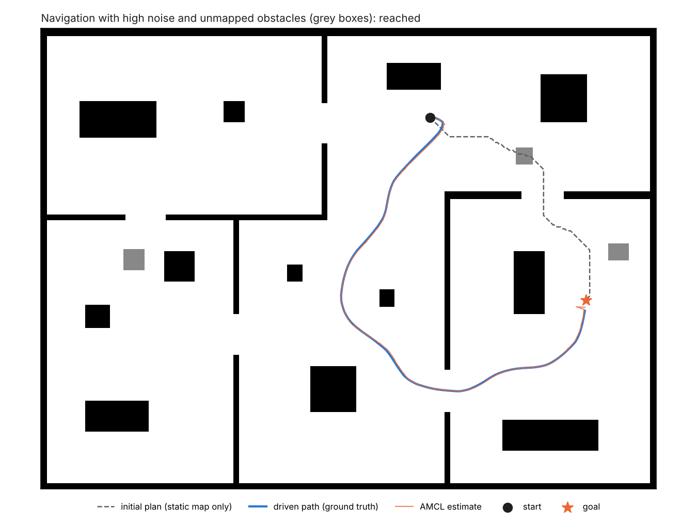

# Autonomous-Navigation-Pioneer-P3AT

Mapping, localisation and autonomous navigation for a Pioneer 3-AT skid-steer robot in ROS 2. In simulation the robot builds a map of an office with SLAM Toolbox and then navigates it with Nav2, localising with AMCL. The core algorithms (scan-matching SLAM, Monte Carlo localisation, grid planning and path following) are also implemented in plain Python. They are evaluated in a benchmark that varies lidar noise, odometry drift and wheel slip, and adds obstacles that are not in the map.

Target platform: **ROS 2 Jazzy on Ubuntu 24.04**, with Gazebo Harmonic.



## Motivation

The Pioneer 3-AT is a four-wheeled skid-steer platform, and skid steering is unkind to odometry. The wheels must slide sideways for the robot to turn at all, so the heading estimated from the encoders drifts quickly, and that drift grows into large position errors after a few metres. A navigation stack for such a robot therefore relies on the laser for everything the encoders cannot provide: the map, the pose within the map, and the obstacles that were not in the map. This project builds that stack and measures where it stops working as the noise grows: how much drift scan matching can absorb, how many particles AMCL needs, whether it recovers when it gets lost, and how often the robot still reaches its goal.

## System

```
 Gazebo Harmonic ── /scan, /odom, /tf ──► SLAM Toolbox ──► map (mapping phase)
       ▲                                        │
       │ /cmd_vel                               ▼
       └──────── Nav2 controller ◄── planner ◄── AMCL (map → odom) ◄── saved map (navigation phase)
```

**Robot model.** `p3at_description` contains a URDF of the Pioneer 3-AT with dimensions close to those of the real platform: a 0.50 × 0.38 m body, wheels of 0.111 m radius, a 0.394 m track, and a 180° planar lidar mounted 0.16 m ahead of the centre. Gazebo's differential-drive system drives both wheels on each side, which is the standard way to model a skid-steer base. The lidar publishes 181 beams out to 10 m with configurable Gaussian noise.

**World and map.** The office (16 × 12 m, five rooms, doorways and furniture) is defined once in Python. `generate_world` writes both the Gazebo world and the matching occupancy map from that definition, so the simulator, the Nav2 map and the benchmark all share exactly the same geometry.

**Mapping.** SLAM Toolbox runs in online asynchronous mode with loop closure. The map is saved with the Nav2 map saver.

**Navigation.** Nav2 uses its default Jazzy configuration, with these values changed through a rewritten parameter file: the robot radius (0.38 m), the base frame, the laser range, AMCL's odometry noise coefficients (raised for skid steering), the particle limit and the recovery parameters. `goal_runner` sends a list of goals through the Nav2 Simple Commander and logs whether each was reached, how long it took and how many recovery behaviours were triggered.

## Benchmark

The benchmark reproduces the same pipeline outside ROS, where the true pose is known at every step. The robot is a unicycle model with multiplicative wheel slip, its encoders follow the standard odometry motion model [1] plus a heading bias per metre travelled, and the lidar is ray-cast against the true map. Lidar noise combines Gaussian range noise, random short readings and dropped returns. Four noise profiles are used:

| Profile | Range noise σ | Short readings | Dropouts | Odometry α₁–α₄ | Heading bias | Wheel slip |
|---|---:|---:|---:|---|---:|---:|
| low | 1 cm | 0% | 0% | 0.02, 0.005, 0.02, 0.005 | 0 | 2% |
| moderate | 3 cm | 2% | 2% | 0.05, 0.01, 0.05, 0.01 | 0.01 rad/m | 5% |
| high | 6 cm | 5% | 5% | 0.10, 0.02, 0.10, 0.02 | 0.03 rad/m | 10% |
| severe | 10 cm | 10% | 10% | 0.20, 0.04, 0.15, 0.04 | 0.05 rad/m | 15% |

The algorithms under test are as follows.

- **Scan-matching SLAM.** A log-odds occupancy grid at 5 cm, with each new scan aligned to the map by a two-stage correlative search over position and heading [2]. There is no loop closure, which makes this a lower bound on what a full SLAM back end such as SLAM Toolbox achieves.
- **AMCL.** Monte Carlo localisation with the odometry motion model, a likelihood-field sensor model, low-variance resampling triggered by the effective sample size, and optional injection of random particles driven by short- and long-term averages of the measurement likelihood (augmented MCL) [1].
- **Planning and control.** An 8-connected A* planner on a costmap inflated by the robot radius, with replanning every 2 s. Obstacles seen by the lidar are added to an obstacle layer as they appear. A pure-pursuit controller slows the robot as the clearance in front of it shrinks.

All results come from `benchmarks/run_benchmarks.py` (seed 2026) and take about eleven minutes on a two-core x86-64 machine with Python 3.13 and NumPy 2.5. Mapping and AMCL tracking use a 51 m exploration tour through all five rooms, driven five times per noise profile.

### Mapping



| Noise profile | ATE odometry (m) | ATE SLAM (m) | Final error odometry (m) | Final error SLAM (m) | Map F1 odometry | Map F1 SLAM |
|---|---:|---:|---:|---:|---:|---:|
| low | 0.175 | 0.061 | 0.180 | 0.041 | 0.754 | 1.000 |
| moderate | 1.802 | 0.109 | 2.595 | 0.032 | 0.242 | 0.902 |
| high | 4.524 | 0.204 | 7.378 | 0.105 | 0.169 | 0.694 |
| severe | 6.561 | 0.559 | 9.189 | 0.798 | 0.085 | 0.230 |

Medians over five tours. ATE is the root-mean-square position error along the trajectory. Map F1 compares the occupied cells of each map with those of a map built from the true poses, at a 10 cm tolerance.

Odometry alone is unusable beyond the low profile. With moderate noise it ends the tour 2.6 m from where it believes it is, and the walls in its map smear into fans, as the figure above shows for the high profile. Scan matching keeps the trajectory error to 0.06–0.20 m up to the high profile and produces a usable map at the moderate level (F1 0.90). The severe profile marks the limit. Once the heading error accumulated between two scans exceeds the matcher's search window, a wrong alignment is accepted and nothing corrects it later, because this implementation has no loop closure. That is precisely the gap SLAM Toolbox's pose-graph back end fills in the ROS stack. Each scan takes about 7 ms to match and insert.

### Localisation



| Noise profile | 50 particles | 100 | 250 | 500 | 1000 |
|---|---:|---:|---:|---:|---:|
| low | 4.9 cm | 4.6 cm | 4.1 cm | 4.2 cm | 4.1 cm |
| moderate | 5.9 cm | 5.6 cm | 5.3 cm | 5.2 cm | 5.2 cm |
| high | 5.8 cm | 5.5 cm | 5.4 cm | 5.4 cm | 5.2 cm |
| severe | 6.6 cm | 6.2 cm | 6.0 cm | 6.0 cm | 5.9 cm |

The values are mean position errors over three tours. In none of the 60 runs did the filter lose track (error above 0.5 m). Once the map is known and the initial pose roughly right, localisation is not the weak point. Even the severe profile, which wrecks odometry-only mapping, raises the mean error only from 4 to 6 cm, because each scan pins the estimate back to the walls. Beyond about 250 particles more particles buy almost nothing. An update costs 0.24 ms with 50 particles and 2.4 ms with 1,000.



| Scenario | Variant | Particles | Recovered | Median time to recover |
|---|---|---:|---:|---:|
| kidnapped (3 m displacement) | augmented MCL | 500 | 10/10 | 29.6 s |
| kidnapped (3 m displacement) | standard MCL | 500 | 0/10 | — |
| global localisation | augmented MCL | 5,000 | 7/10 | 30.0 s |
| global localisation | standard MCL | 5,000 | 5/10 | 0.4 s |

Tracking a known pose is one thing; recovering when the filter is wrong is another. In the kidnapped-robot test, the estimate is displaced by 3 m after 24 s of correct tracking (moderate noise). Standard MCL never recovers, because all its particles sit in the wrong place and resampling only reinforces them. Augmented MCL notices the sudden fall in measurement likelihood, injects random particles, and recovered in all ten trials, after a median of 30 s. Global localisation from a uniform prior shows the same mechanism with a cost. When standard MCL picks the right room it does so almost immediately, but when it picks the wrong one it stays wrong (5 of 10 trials). Augmented MCL succeeds in two more trials but takes longer, more than 100 s in three trials, because the random particles also disturb filters that were already converging. In practice an initial pose estimate, as Nav2 expects, is far more reliable than global localisation in an office with several similar rooms.

### Navigation



| Noise profile | Scenario | Success | Collisions | Median time (s) | Mean localisation error (cm) | Max localisation error (cm) |
|---|---|---:|---:|---:|---:|---:|
| low | known map | 10/10 | 0 | 25.0 | 3.9 | 17.1 |
| low | unmapped obstacles | 10/10 | 0 | 33.2 | 3.6 | 27.3 |
| moderate | known map | 9/10 | 0 | 28.9 | 5.2 | 21.8 |
| moderate | unmapped obstacles | 10/10 | 0 | 44.2 | 5.5 | 24.4 |
| high | known map | 8/10 | 0 | 49.0 | 5.0 | 26.7 |
| high | unmapped obstacles | 7/10 | 0 | 68.1 | 58.4 | 948.4 |
| severe | known map | 7/10 | 0 | 97.8 | 6.0 | 251.6 |
| severe | unmapped obstacles | 2/10 | 0 | 117.7 | 114.7 | 1076.9 |

Ten start–goal pairs, each more than 6 m apart (8.5 m on average), are driven under every profile. Each pair is driven twice: once in the mapped office, and once with three boxes that are not in the map, one of them placed on the robot's planned route. A run succeeds if the robot ends within 35 cm of the goal without touching an obstacle.

There was not a single collision in 80 runs. The speed scaling on frontal clearance kept the robot at least 30 cm from every obstacle. On the known map, failures share one cause: the robot believes it has arrived while its true position is more than 35 cm from the goal. This is localisation error at the goal, not a planning failure. Higher noise mostly costs time. The robot slows down for the short readings that the noise model injects in front of it, and the median time to goal quadruples from the low to the severe profile.

Unmapped obstacles behave differently. With low and moderate noise the robot detects the blocking box, replans around it and arrives, covering about 4 m more on average than on the known map (see the example below). With high and severe noise most failures are time-outs, and the localisation figures show why: the mean AMCL error jumps from 5 cm to 58 cm and 115 cm, with peaks of several metres. A likely explanation is that the unmapped boxes return laser readings that the map cannot explain, which lowers the measurement likelihood exactly as a kidnapping does. Augmented MCL then injects random particles, and with large odometry noise some of these settle in the wrong place. Unexpected obstacles are therefore a localisation problem as much as a planning one, which is why AMCL offers beam skipping (ignoring beams that most particles cannot explain), and why its recovery parameters deserve tuning for a given environment. The control loop, including AMCL with 500 particles, the obstacle layer and replanning, takes a median of 6 ms per 10 Hz step.



## What the benchmark does and does not show

The benchmark replaces Gazebo's physics with a kinematic model. Its slip and odometry errors are drawn from parametric distributions, not from simulated tyre–ground contact, and the lidar is a 2D ray-caster against the same grid used for the map. The world is static apart from the added boxes, and there are no people or moving objects. The SLAM implementation has no loop closure, by design, so its severe-noise results understate a full SLAM system. These choices make it possible to measure every error against ground truth and to run hundreds of trials in minutes. The ROS stack uses the production implementations (SLAM Toolbox, Nav2 AMCL, Nav2 planners and controllers), configured from the same geometry.

## Installation (ROS 2 Jazzy, Ubuntu 24.04)

```bash
sudo apt install ros-jazzy-navigation2 ros-jazzy-nav2-bringup ros-jazzy-nav2-simple-commander \
                 ros-jazzy-slam-toolbox ros-jazzy-ros-gz ros-jazzy-xacro \
                 python3-numpy python3-scipy python3-yaml python3-pil
mkdir -p ~/p3at_ws/src && cd ~/p3at_ws/src
git clone https://github.com/MubeenChaghtai/Autonomous-Navigation-Pioneer-P3AT.git
cd ~/p3at_ws
rosdep install --from-paths src --ignore-src -y
colcon build --symlink-install --base-paths src/Autonomous-Navigation-Pioneer-P3AT/src
source install/setup.bash
```

## Running

Build a map: start Gazebo, SLAM Toolbox and RViz, drive the robot with the keyboard, and save the map.

```bash
ros2 launch p3at_navigation slam.launch.py
ros2 run teleop_twist_keyboard teleop_twist_keyboard
ros2 run nav2_map_server map_saver_cli -f ~/office_map
```

Navigate on the provided map, or on your own with `map:=~/office_map.yaml`. Set goals with the Nav2 Goal tool in RViz, or run the goal list automatically:

```bash
ros2 launch p3at_navigation navigation.launch.py
ros2 launch p3at_navigation navigation.launch.py run_goals:=true lidar_noise:=0.05
```

Results of the goal list are written to `/tmp/p3at_goal_results.csv`. Use `lidar_noise` to change the laser noise in Gazebo, and edit `config/goals.yaml` to change the goals.

## Reproducing the benchmark

ROS is not needed.

```bash
pip install -r requirements.txt
python benchmarks/run_benchmarks.py
python benchmarks/make_figures.py
pytest -q src/p3at_navigation/test
```

The unit tests check ray-casting distances, the exported ROS map, the decomposition of odometry motion, map updates for walls and free space, recovery of a known offset by the scan matcher, AMCL tracking along a route, SLAM improving on odometry under high noise, collision-free planning, the stopping and slowing behaviour of the path follower, and a complete navigation run around an unmapped obstacle.

## Repository layout

```
Autonomous-Navigation-Pioneer-P3AT/
├── src/
│   ├── p3at_description/                  URDF (xacro) with Gazebo Harmonic plugins
│   └── p3at_navigation/
│       ├── p3at_navigation/
│       │   ├── world.py                   office layout, occupancy grids, world and map export
│       │   ├── sensors.py                 lidar ray-casting, noise and odometry models
│       │   ├── slam.py                    occupancy mapping and correlative scan matching
│       │   ├── amcl.py                    Monte Carlo localisation with recovery
│       │   ├── planning.py                costmap, A*, pure pursuit
│       │   ├── simulation.py              closed-loop navigation and mapping experiments
│       │   ├── goal_runner.py             Nav2 goal sequence with logging (ROS 2)
│       │   └── generate_world.py          writes worlds/office.sdf and maps/office.yaml
│       ├── launch/                        simulation, slam, navigation
│       ├── config/                        SLAM Toolbox, bridge, goals
│       ├── worlds/  maps/
│       └── test/
├── benchmarks/                            run_benchmarks.py, make_figures.py
└── results/                               CSV, JSON, tables and figures
```

## Licence

MIT. See `LICENSE`.

## Author

Mubeen Naeem Chaghtai, MS Robotics and Intelligent Machine Engineering, NUST, Islamabad.
GitHub: [MubeenChaghtai](https://github.com/MubeenChaghtai)
